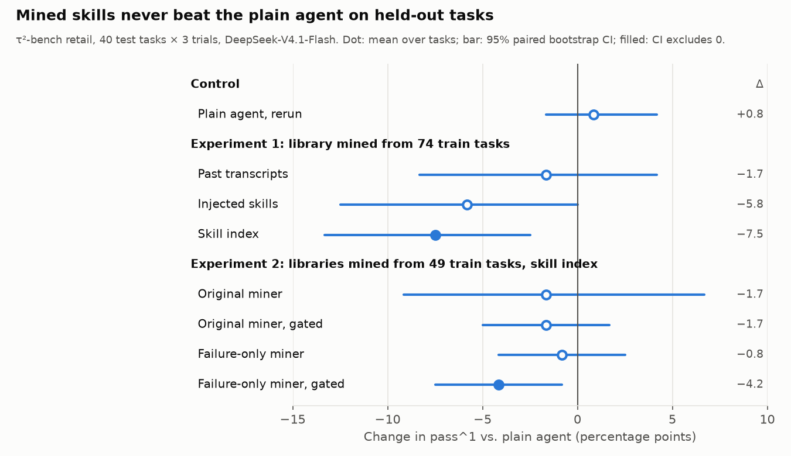

# retail-agent-skills

A customer-service agent for the **retail domain of [τ²-bench](https://github.com/sierra-research/tau2-bench)**
(order lookup, cancellation, modification, returns and exchanges under a written policy) that
**learns reusable skills from its own past conversations**.

The question: if an agent keeps transcripts of its earlier conversations and only knows
whether each one ended well, can it distill procedures that make it more reliable on
requests it has never seen? And how should that memory be put into context?

[](https://github.com/RenXinghan/retail-agent-skills/actions/workflows/ci.yml)

## At a glance

<picture>
  <source media="(prefers-color-scheme: dark)" srcset="docs/results-dark.png">
  
</picture>

- **Mined skills did not beat the plain agent** on 40 held-out tasks × 3 trials. The original
  miner's library cost 7.5 points of pass^1 (95% CI excludes zero); mining only from failures
  removed the harm but added nothing. A rerun of the plain agent moved by 0.8 points, so the
  drops are not evaluation noise.
- **The model never used an optional skill tool** (0 loads in 5 pilot conversations), even when
  told to; forcing one skill-selection call per customer turn fixed it.
- **The library matters more than the method**: the same miner gave −7.5 or −1.7 points
  depending on which 74 or 49 tasks it learned from.

[Example conversation](docs/example-conversation.md) ·
[Engineering notes](docs/engineering-notes.md) ·
[Full results](#results)

## How the agent works

τ²-bench drives the conversation turn by turn: a simulated customer talks to the agent, and
the agent either replies or calls one environment tool. Each turn of this agent is one run of a
small [LangGraph](https://github.com/langchain-ai/langgraph) state graph:

```
                ┌─► retrieve ────────────────┐   (trajectories, skills_inject)
ingest ─────────┼─► route ──► read_skills ───┼─► act ──► finalize ──► reply or tool call
  (customer     └────────────────────────────┘    ▲  │
   turns only)                                    │  ▼   (skills_index, optional)
                                               read_skills
```

- **retrieve** runs on customer turns in the `trajectories` and `skills_inject` modes and ranks
  memory (past transcripts or skills) with BM25+ over everything the customer has said so far.
- **route** runs on customer turns in `skills_index` mode. The prompt lists only skill names and
  one-line descriptions; route is one LLM call forced to answer with `read_skills`, choosing the
  matching skills or none. The model can load more skills later in the turn.
- **read_skills** is an *internal* tool: its calls are answered inside the graph and never reach
  the environment, so they cannot change what the grader sees. At most 3 per turn.
- **act** is one LLM call with the domain policy, any retrieved memory, and the tools.
- **finalize** sums tokens, cache hits and cost over all LLM calls in the turn and records which
  memory was retrieved or read, so every reply in the results file says what context produced it.

**Why route is forced.** The first version only offered the skill tool. In a 5-task pilot
DeepSeek-V4.1-Flash never called it (0 reads over 5 conversations). After both the prompt and
the tool description were rewritten to say "read a matching skill before anything else", it
still skipped the tool on 3 of 3 opening requests and went straight to authentication, which
the policy requires first. It does call the tool when asked directly, and a forced call picks sensible skills
(exchange → exchange skill, return → return skill, cancel → none when the library has no
cancellation skill). Making the selection a mandatory step keeps the context small (only chosen
skills are loaded) without relying on the model to remember that memory exists.

## Memory configurations

| mode | what goes into context |
|---|---|
| `vanilla` | policy + tools (the τ²-bench reference prompt) |
| `trajectories` | top-k successful past transcripts as examples |
| `skills_inject` | top-k full skills from the mined library |
| `skills_index` | index of all skills; on each customer turn the model picks which to load |

## Learning protocol

1. Run the plain agent on the **train** split (74 tasks, several trials each).
2. **Mine skills** (`retail_agent/mining.py`). For each task the miner gets the policy and the
   agent's transcripts labeled only SUCCESS/FAILURE. When both outcomes exist it contrasts
   them; otherwise it studies the single attempt. It proposes candidate skills (trigger cues,
   steps, pitfalls), which a second pass merges into a library of at most 12 skills with
   provenance. The miner never sees the benchmark's gold actions.
3. Evaluate every configuration on the **test** split (40 held-out tasks). Report pass^k
   (the probability that all k independent trials succeed), tokens and LLM calls per turn.

`ras run` refuses to evaluate on any task that the skill library or trajectory store was built
from, and `ras mine` refuses inputs that did not come from the train split.

## Results

DeepSeek-V4.1-Flash (non-thinking, temperature 0) plays the agent, the simulated customer, the
NL-assertion judge and the miner. Train: 74 tasks × 2 trials (plain agent pass^1 0.831), mined
into 12 skills from 121 candidates (`skills/main.yaml`). Test: 40 held-out tasks × 3 trials.

| mode | pass^1 | pass^2 | pass^3 | Δ pass^1 vs vanilla (95% CI) | tasks worse / better | agent tokens per conversation | agent cost per conversation | skills loaded per conversation |
|---|---|---|---|---|---|---|---|---|
| `vanilla` | **0.925** | **0.883** | **0.850** | — | — | 78k | ¥0.011 | — |
| `trajectories` | 0.908 | 0.867 | **0.850** | −0.017 [−0.083, +0.042] | 4 / 4 | 157k | ¥0.036 | — |
| `skills_inject` | 0.867 | 0.800 | 0.750 | −0.058 [−0.125, 0.000] | 7 / 2 | 87k | ¥0.024 | top 3 per turn |
| `skills_index` | 0.850 | 0.767 | 0.700 | −0.075 [−0.133, −0.025] | 7 / 0 | 121k | ¥0.019 | 5.0 |

CIs are paired bootstrap intervals over the 40 tasks. Cost is DeepSeek's off-peak RMB price with
cache hits (79–94% of prompt tokens). The whole run cost about ¥15 and took one hour.

What this shows:

1. **The mined skills hurt.** The skill-index agent was worse on 7 tasks and better on none, and
   its interval excludes zero; injecting skills trends the same way. Retrieving whole successful
   transcripts was neutral but doubled the tokens.
2. **There was little to gain.** The plain agent already solves 34 of 40 test tasks in all three
   trials, and the library mostly restates the policy as step lists (authenticate, check status,
   confirm before writing). A skill can only help on the handful of tasks the model still fails.
3. **The failures are ordinary mistakes, not bad instructions.** In the regressed tasks
   inspected so far (39, 49, 60, 86, 100) the agent picked the wrong variant or payment method,
   saved an address the simulated customer invented, or dropped a second request. The plain agent
   makes the same kinds of mistakes, only less often, and the skills these runs loaded
   (`modify_pending_order_items`, `modify_pending_order_address`, `verify_variant_availability`)
   agree with the policy. Conversations were not longer (6.4 vs 7.0 customer turns), but the
   agent's context was 56% larger. The mechanism is not pinned down yet.

### Experiment 2: failure-only mining and validation gating

The train split is divided into a mining part (49 tasks) and a validation part (25 tasks, every
third id). Two libraries are mined from the mining part's runs: the original miner (at most 12
skills) and a failure-only miner, which looks only at tasks the plain agent failed at least once
and writes one skill per failure around the mistake made (at most 6 skills). Each library runs
on the validation part (2 trials) and is gated: a skill stays if at least two validation
conversations loaded it and those conversations did no worse than the plain agent on the same
tasks (`ras gate`). Every library then runs in `skills_index` mode on the test split (40 × 3).

| library | skills | pass^1 | pass^3 | Δ pass^1 vs vanilla (95% CI) | tasks worse / better |
|---|---|---|---|---|---|
| `vanilla`, rerun | — | 0.933 | 0.850 | +0.008 [−0.017, +0.042] | 1 / 2 |
| original miner, 74 tasks (Experiment 1) | 12 | 0.850 | 0.700 | −0.075 [−0.133, −0.025] | 7 / 0 |
| original miner, 49 tasks | 12 | 0.908 | 0.800 | −0.017 [−0.092, +0.067] | 7 / 4 |
| … gated | 5 | 0.908 | 0.825 | −0.017 [−0.050, +0.017] | 3 / 1 |
| failure-only miner, 49 tasks | 6 | 0.917 | 0.825 | −0.008 [−0.042, +0.025] | 3 / 2 |
| … gated | 4 | 0.883 | 0.750 | −0.042 [−0.075, −0.008] | 5 / 0 |

1. **Evaluation noise is small.** Rerunning the plain agent moved pass^1 by 0.008, with 3 tasks
   changing. The drops above are not run-to-run noise.
2. **The library matters more than the method.** The same miner gave −0.075 from 74 tasks and
   −0.017 from 49. Which skills come out of mining, and how they are worded, is itself a large
   source of variance, so one mined library says little about a mining method.
3. **Mining only from failures removed the harm** with half as many skills (−0.008, interval
   includes zero) but did not beat the plain agent, which already solves 34 of 40 test tasks in
   every trial.
4. **Gating on 25 validation tasks did not help**, and hurt the failure-only library.
   Attributing about 50 conversations to skills by co-occurrence is too noisy to separate good
   skills from bad ones.

Both experiments together cost about ¥30 on DeepSeek's API.

Next: estimate a mining method over several independently mined libraries, gate on more
validation conversations or by ablating one skill at a time, and move to the harder airline
domain or a weaker agent, where the plain agent leaves more failures to fix.

## Quickstart

```bash
./scripts/setup.sh                 # clones τ²-bench at a pinned commit, creates .venv (Python 3.12, uv)
cp .env.example .env               # DeepSeek V4.1 Flash by default; any litellm provider works
.venv/bin/ras ping                 # one tool-calling request to check the provider

# small pilot: 5 tasks, 1 trial each
NUM_TASKS=5 TRAIN_TRIALS=1 TEST_TRIALS=1 TAG=pilot ./scripts/run_experiments.sh

# full protocol: train x2 trials, mine, 4 configurations x 3 trials on test
./scripts/run_experiments.sh
```

Individual steps:

```bash
ras run --mode vanilla --split train --trials 2 --name train-vanilla
ras mine --results results/raw/train-vanilla/results.json --out skills/retail.yaml
ras run --mode skills_index --skills skills/retail.yaml --split test --trials 3
ras report results/raw/*/results.json
```

Interrupted runs resume when the same command is rerun. Experiment 2 is
`./scripts/run_experiment2.sh`; both scripts keep macOS awake while they run.

Analysis from finished runs:

```bash
# paired per-task comparison against the plain agent, plus a per-task CSV
ras compare --baseline results/raw/main-test-vanilla/results.json \
  results/raw/main-test-*/results.json results/raw/exp2-test-*/results.json \
  --csv results/per_task.csv
.venv/bin/python scripts/plot_results.py   # docs/results-{light,dark}.png from that CSV
```

`results/per_task.csv` (committed) holds per-task successes for every test run, so the
intervals and the figure can be reproduced without the raw transcripts.

## Notes

- τ²-bench grades some retail tasks with an LLM judge of natural-language assertions, which it
  hard-codes to an OpenAI model. `ras run` points that judge at `--judge-llm` (by default the user
  simulator model), so numbers are comparable across configurations here but not directly with
  the official leaderboard.
- The same user-simulator model and seed are used for every configuration.
- [docs/engineering-notes.md](docs/engineering-notes.md) collects the problems hit along the
  way: thinking mode and tool calls, an optional tool the model never used, prompt-cache hit
  rates, BM25 on tiny corpora, laptop sleep during long runs.

## Layout

```
src/retail_agent/
  agent.py         LangGraph turn graph, memory modes, internal read_skills tool
  skills.py        Skill schema, YAML library, BM25+ retrieval
  trajectories.py  compact transcripts from τ²-bench results, trajectory store
  mining.py        reflect-then-consolidate miner, optional failure-only mode
  gating.py        validation gating of a skill library
  splits.py        fixed mining / validation split of the train tasks
  stats.py         per-task success and paired bootstrap comparison
  cli.py           ras run | mine | gate | compare | report | ping
scripts/           setup, experiment protocols, results figure
skills/            mined libraries (and their candidates) used in the experiments
results/           summary tables and per-task successes; raw transcripts are not committed
docs/              results figure, example conversation, engineering notes
tests/             offline tests with scripted LLMs (run in CI)
```
